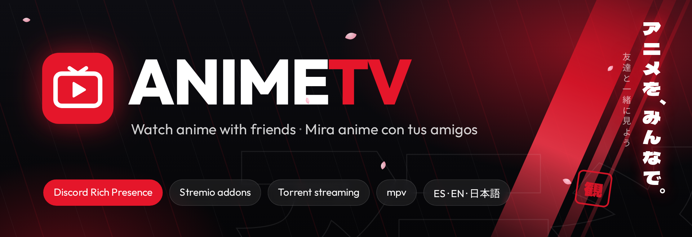
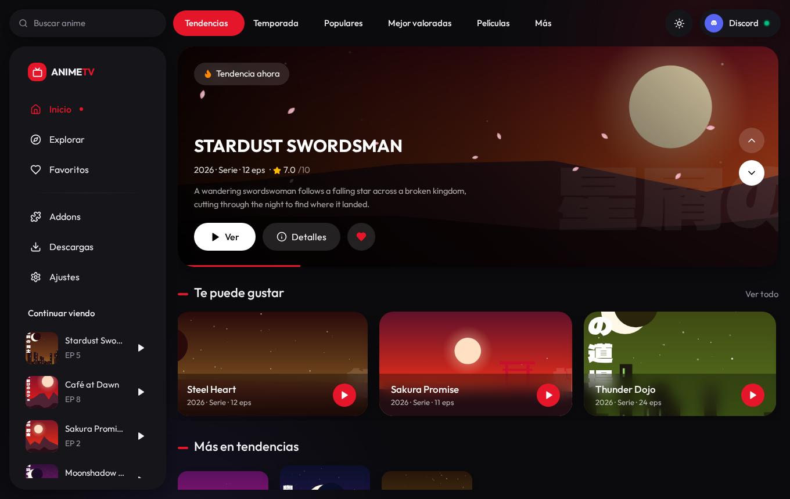
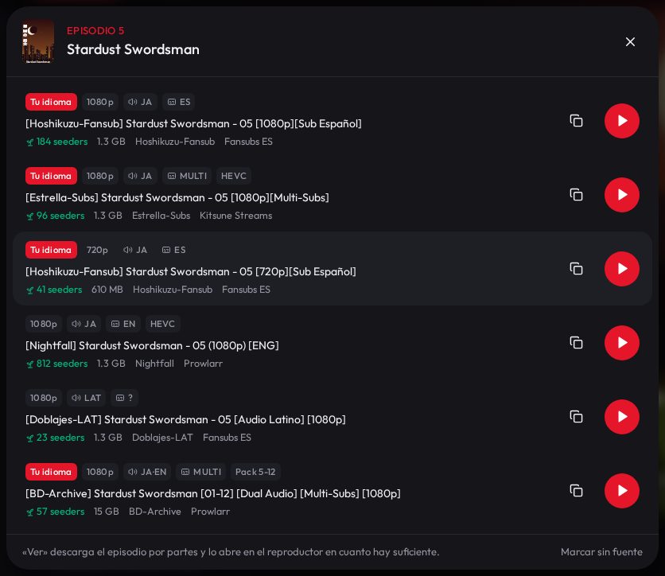
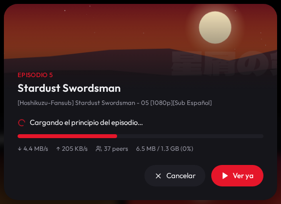
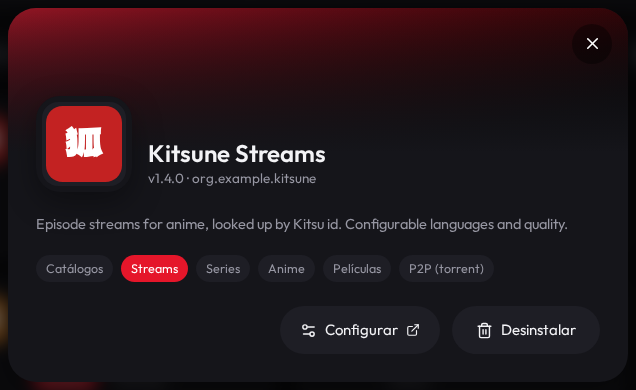
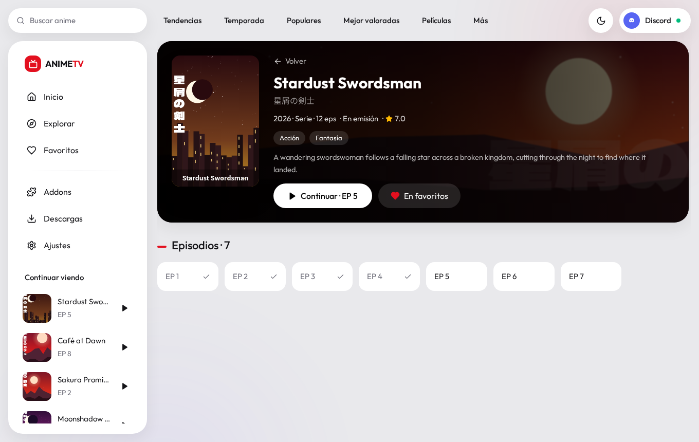
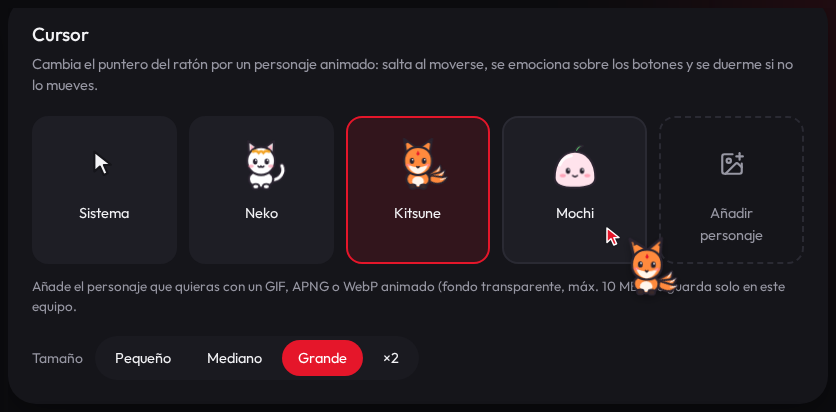
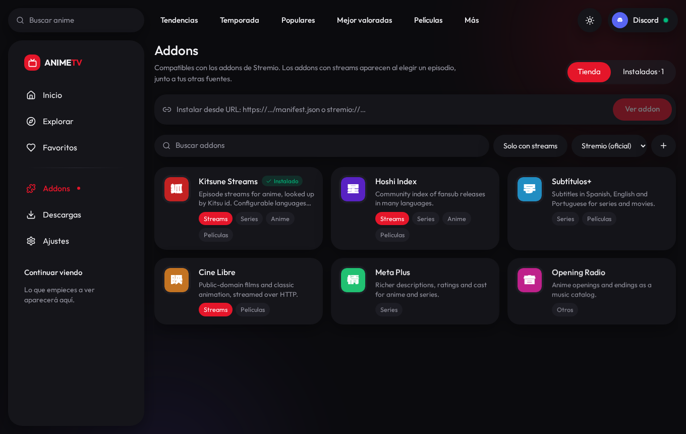
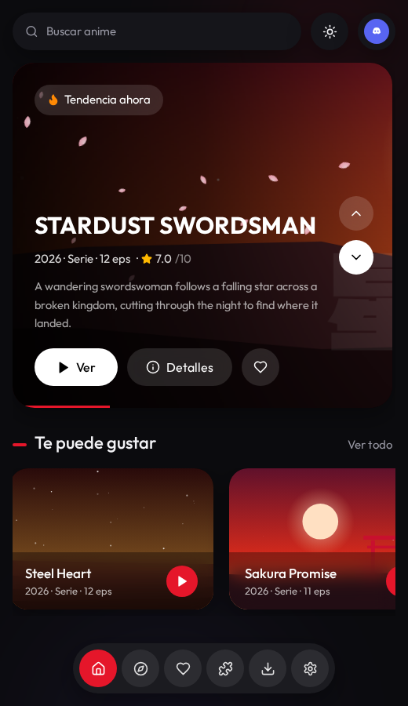
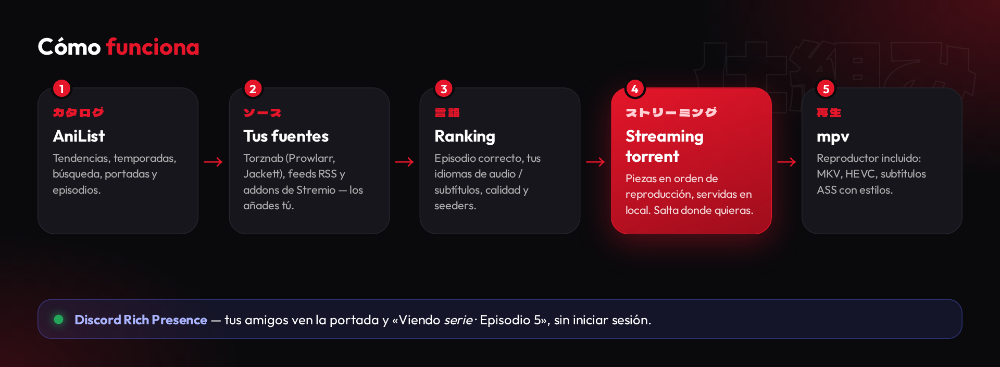

<p align="center">
  
</p>

<p align="center">
  <a href="README.md">English</a> · <b>Español</b>
</p>

<p align="center">
  <a href="https://github.com/eirikrrrr/ani-tv/releases"></a>
  <a href="https://github.com/eirikrrrr/ani-tv/actions/workflows/windows.yml"></a>
  
  
</p>

<p align="center">
  <br>
  <b>Un reproductor de anime de escritorio que enseña a tus amigos lo que estás viendo.</b><br>
  Explora el catálogo, elige un episodio en <i>tu</i> idioma, empieza a verlo en segundos —<br>
  y tu perfil de Discord cambia a la portada de la serie: <i>«Viendo … · Episodio 5»</i>.
</p>

<p align="center">
  
</p>

> [!NOTE]
> Anime TV está en **alpha**. El catálogo, Discord, las fuentes, los addons y el streaming
> por torrent funcionan; puede haber detalles por pulir. Las capturas usan un catálogo inventado.

---

## ✨ Lo más destacado

| | |
|:--|:--|
| 🎌 **Primero tus idiomas** — la app lee en el nombre de cada release el idioma del audio y de los subtítulos (español, español latino, inglés, raws en japonés, portugués, francés…) y ordena los resultados según *tu* lista, luego por calidad y seeders. |  |
| ⚡ **Empieza en segundos** — el episodio se descarga en orden de reproducción y se abre en **mpv** (incluido) en cuanto hay búfer. Salta a cualquier punto: esas partes se descargan primero. |  |
| 🧩 **Addons compatibles con Stremio** — tienda dentro de la app, instalación por URL o enlace `stremio://` y modal para instalar con un clic. Los addons se consultan por id de Kitsu / IMDb / MAL automáticamente. |  |
| 🎮 **Discord Rich Presence** — el logo de la app mientras navegas; la portada, el episodio y el tiempo mientras ves. Funciona sin configurar nada y sin iniciar sesión. |  |
| 🦊 **Cursor animado y movimiento** — personajes chibi (o tu propio GIF) como puntero, pétalos de sakura y transiciones suaves. Tema oscuro y claro. |  |

<p align="center">
  
  
</p>

## 🔧 Cómo funciona

<p align="center">
  
</p>

## 📥 Descarga

1. Entra en **[Releases](https://github.com/eirikrrrr/ani-tv/releases)** y descarga la última:
   - `Anime.TV_…_x64-setup.exe` — instalador (recomendado), o el `.msi`
   - `anime-tv-…-windows-x64-portable.zip` — sin instalar: descomprime y abre `anime-tv.exe`
2. Windows 10/11 ya traen WebView2. Los ejecutables aún no están firmados, así que
   SmartScreen puede avisar: *Más información → Ejecutar de todas formas*.

## 🚀 Primeros pasos

1. **Añade de dónde salen los episodios** — la app **no** trae ninguna fuente:
   - **Addons** → instala un addon de Stremio desde la *Tienda* o pega su URL, **o**
   - **Ajustes → Fuentes** → añade un indexador **Torznab** (Prowlarr / Jackett) o un feed
     **RSS** (pon `{query}` donde va la búsqueda) y pulsa *Probar*.
2. **Ajustes → Idiomas preferidos** — por ejemplo *Subtítulos · Español* y luego *Subtítulos · Inglés*.
3. Abre una serie, elige un episodio y un release → **Ver**.
4. Con Discord abierto, tus amigos ven lo que estás viendo. 🎉

## 🗂️ Fuentes y addons

| Tipo | Qué es | Notas |
|---|---|---|
| **Torznab** | La API que exponen Prowlarr y Jackett para cientos de sitios | URL tipo `http://localhost:9696/1/api` + API key; categoría anime 5070 por defecto |
| **RSS** | Cualquier feed de torrents | `{query}` se sustituye por la búsqueda; el *idioma de subtítulos por defecto* ayuda con feeds que no lo indican |
| **Addon de Stremio** | Un servicio HTTP con un `manifest.json` | Los streams se piden por id de Kitsu / IMDb / MAL / AniList; en los packs viene el archivo exacto |

Los **catálogos de addons** (listas en el formato `addonscollection.json` de Stremio)
alimentan la tienda. Solo se incluye el catálogo oficial de Stremio; puedes añadir otros por URL.

<details>
<summary><b>Etiquetas de idioma que entiende el parser</b></summary>

| Etiqueta en el nombre | Se detecta como |
|---|---|
| `Sub Español`, `VOSE`, `ESP`, `Spanish` | subtítulos en español |
| `Sub Latino`, `Sub Español Latino` | subtítulos en español latino |
| `Audio Latino`, `Latino`, `LAT dub` | audio en español latino |
| `Castellano`, `Audio Español` | audio en español (España) |
| `ENG`, `English`, `Eng Sub` | subtítulos en inglés |
| `English Dub`, `Dubbed` | audio en inglés |
| `Dual Audio` | audio japonés + inglés |
| `Multi-Subs`, `MultiSub` | varias pistas de subtítulos |
| `RAW`, `Raws` | audio japonés, sin subtítulos |
| `VOSTFR` · `PT-BR`, `Legendado` | subtítulos en francés · portugués de Brasil |
| 🇪🇸 🇲🇽 🇬🇧 🇧🇷 🇫🇷… (addons) | idioma de subtítulos |

</details>

## 🔒 Privacidad y seguridad

- **Los torrents comparten:** mientras ves también subes partes a otros peers y tu IP es
  visible para ellos. En *Descargas* hay límite de subida (500 KB/s por defecto) y opción de
  borrar el episodio al terminar.
- El motor torrent solo hace **conexiones salientes**: no abre puertos ni usa UPnP.
- El servidor local de streaming escucha en `127.0.0.1`, con puerto aleatorio y un token
  aleatorio en cada URL, así que otros programas o páginas web no pueden usarlo.
- Las fuentes y los addons se tratan como datos no confiables: timeouts, límites de tamaño
  y solo se aceptan magnets, URLs de torrents y streams http(s).

## 🗺️ Hoja de ruta

- [x] Catálogo, favoritos, continuar viendo, tema oscuro y claro
- [x] Discord Rich Presence
- [x] Fuentes Torznab / RSS y ranking por idioma
- [x] Addons compatibles con Stremio con tienda integrada
- [x] Streaming por torrent + mpv incluido
- [ ] Reproductor dentro de la ventana, recordar posición, siguiente episodio automático
- [ ] Sincronizar progreso con AniList / MAL, avisos de episodios nuevos
- [ ] Instaladores firmados y actualización automática · builds para Linux y macOS

## 🛠️ Desarrollo

Requisitos: Node 20+, Rust estable (y los [requisitos de Tauri](https://tauri.app/start/prerequisites/) para la app de escritorio).

```bash
npm install
npm run dev          # interfaz en el navegador en http://localhost:1420 (sin Discord ni torrents)
npm run tauri dev    # la app de escritorio
cargo test           # tests del núcleo (parser, ranking, fuentes, addons, servidor de streaming)
cargo run -p anime-tv-core --example stream_check -- '<magnet>'   # prueba de streaming de punta a punta
```

```
core/        anime-tv-core — Rust sin ventana y testeable: Discord IPC, parser de releases,
             fuentes (Torznab/RSS/addons de Stremio), ranking, motor de streaming torrent
src-tauri/   la app Tauri: comandos que llama la interfaz, lanzador de mpv
src/         interfaz en React + TypeScript + Tailwind
.github/     build de Windows en cada push a main; un tag vX.Y.Z-alpha.N publica una pre-release
```

## ⚖️ Sobre el contenido

Anime TV es un reproductor. **No** aloja, indexa ni distribuye vídeo, y no trae fuentes ni
addons de contenido: cada usuario añade los suyos. Usa solo contenido que tengas derecho a
ver; descargar o compartir anime con licencia sin permiso puede ser ilegal en tu país.

## 🙏 Créditos y terceros

- [mpv](https://mpv.io) (GPLv2+) — incluido en Windows como programa aparte, build de
  [shinchiro/mpv-winbuild-cmake](https://github.com/shinchiro/mpv-winbuild-cmake);
  código fuente: <https://github.com/mpv-player/mpv>
- [librqbit](https://github.com/ikatson/rqbit) (Apache-2.0) — motor torrent
- API de [AniList](https://anilist.co) — catálogo e imágenes · [ani.zip](https://api.ani.zip) — correspondencia de ids
- El [protocolo de addons de Stremio](https://github.com/Stremio/stremio-addon-sdk) — Anime TV
  no está afiliado a Stremio ni a Discord
- Fuentes tipográficas: Outfit, Noto Sans JP, Dela Gothic One (SIL Open Font License)

**Licencia:** por definir.
