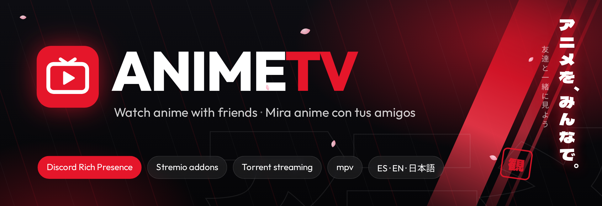
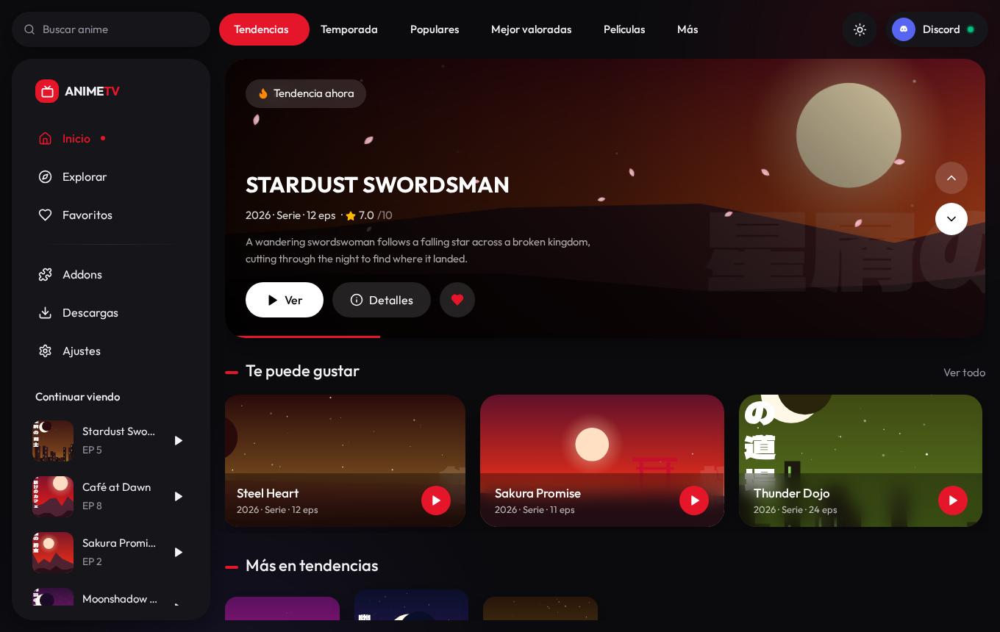
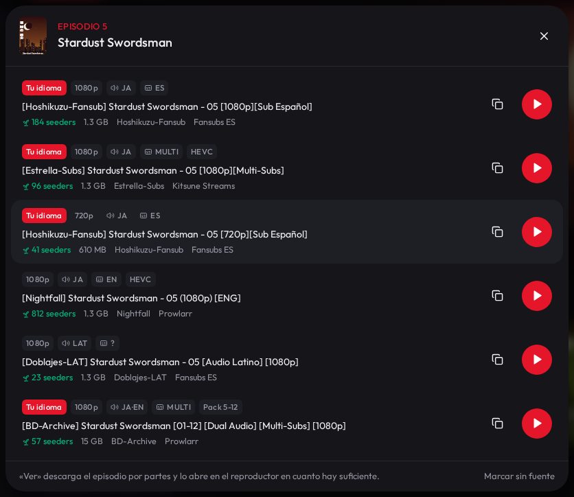
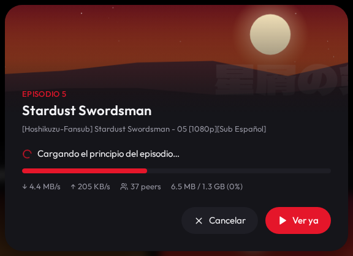
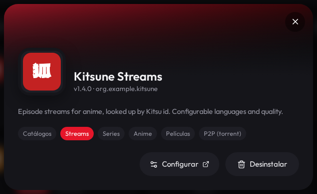
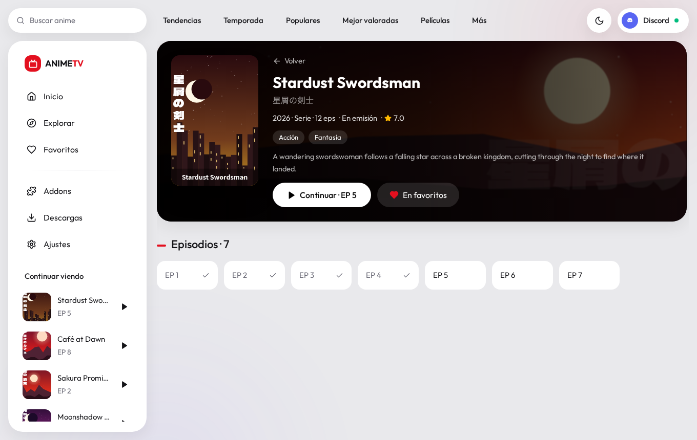
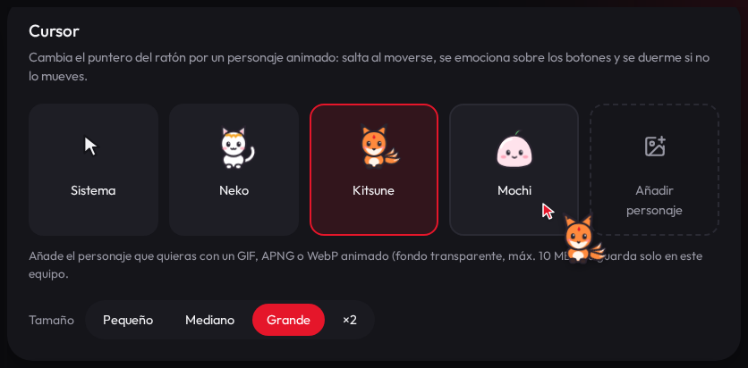
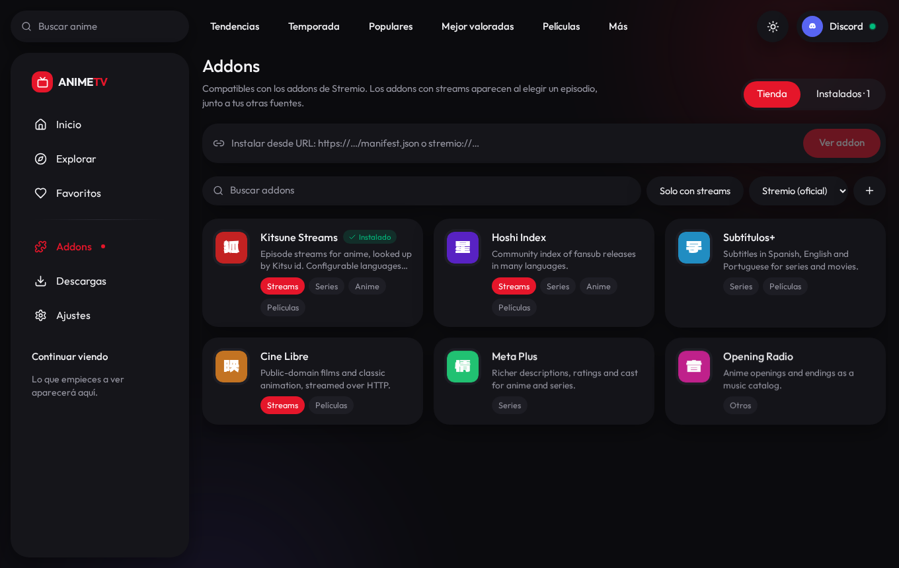
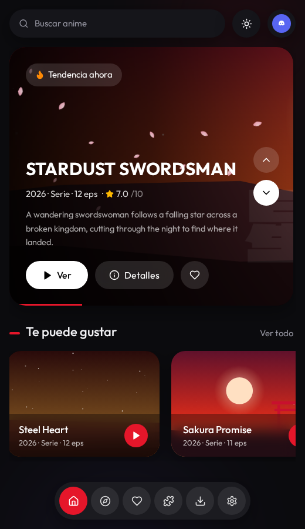
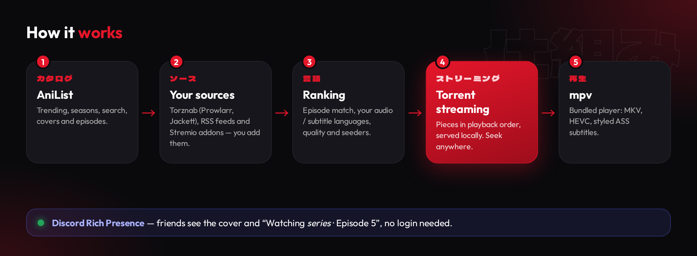

<p align="center">
  
</p>

<p align="center">
  <b>English</b> · <a href="README.es.md">Español</a>
</p>

<p align="center">
  <a href="https://github.com/eirikrrrr/ani-tv/releases"></a>
  <a href="https://github.com/eirikrrrr/ani-tv/actions/workflows/windows.yml"></a>
  
  
</p>

<p align="center">
  <br>
  <b>A desktop anime player that shows your friends what you're watching.</b><br>
  Browse the catalogue, pick an episode in <i>your</i> language, stream it in seconds —<br>
  and your Discord profile switches to the series cover: <i>“Watching … · Episode 5”</i>.
</p>

<p align="center">
  
</p>

> [!NOTE]
> Anime TV is in **alpha**. Catalogue, Discord, sources, addons and torrent streaming
> work; expect rough edges. The interface is in **Spanish** for now (menu names below are
> given as they appear in the app). The screenshots use an invented catalogue.

---

## ✨ Highlights

| | |
|:--|:--|
| 🎌 **Your languages first** — release names are parsed for audio and subtitle languages (Spanish, Latin-American Spanish, English, Japanese raws, Portuguese, French…). Results are ranked by *your* order, then quality and seeders. |  |
| ⚡ **Streams in seconds** — the episode downloads in playback order and plays in the bundled **mpv**, right inside the app window, as soon as the start is buffered. Seek anywhere: those pieces come first. |  |
| 🧩 **Stremio-compatible addons** — an in-app store, install by URL or `stremio://` link, one-click install dialog. Addons are queried by Kitsu / IMDb / MAL id automatically. |  |
| 🎮 **Discord Rich Presence** — app logo while browsing; series cover, episode and elapsed time while watching. Works out of the box, no login. |  |
| 🦊 **Animated cursor & motion** — chibi characters (or your own GIF) as the mouse pointer, sakura petals, smooth transitions. Dark and light themes. |  |

<p align="center">
  
  
</p>

## 🔧 How it works

<p align="center">
  
</p>

## 📥 Download

1. Go to **[Releases](https://github.com/eirikrrrr/ani-tv/releases)** and download the latest:
   - `Anime.TV_…_x64-setup.exe` — installer (recommended), or `.msi`
   - `anime-tv-…-windows-x64-portable.zip` — no install: unzip and run `anime-tv.exe`
2. Windows 10/11 already include WebView2. The builds are not code-signed yet, so
   SmartScreen may warn: *More info → Run anyway*.

## 🚀 Quick start

1. **Add where episodes come from** — the app ships with **no** sources:
   - **Addons** → install a Stremio addon from the store (*Tienda*) or paste its URL, **or**
   - **Ajustes → Fuentes** (Settings → Sources) → add a **Torznab** indexer (Prowlarr /
     Jackett) or an **RSS** feed (put `{query}` where the search text goes) and press *Probar* (Test).
2. **Ajustes → Idiomas preferidos** (preferred languages) — e.g. *Subtítulos · Español*, then
   *Subtítulos · Inglés*.
3. Open a series, pick an episode, choose a release → **Ver** (Watch).
4. Have Discord open: your friends see what you're watching. 🎉

## 🗂️ Sources & addons

| Type | What it is | Notes |
|---|---|---|
| **Torznab** | The API that Prowlarr and Jackett expose for hundreds of sites | URL like `http://localhost:9696/1/api` + API key; anime category 5070 by default |
| **RSS** | Any torrent feed | `{query}` is replaced by the search; a per-source *default subtitle language* helps feeds that don't tag it |
| **Stremio addon** | An HTTP service with a `manifest.json` | Streams are requested by Kitsu / IMDb / MAL / AniList id; packs come with the exact file to play |

Addon **catalogues** (lists of addons in Stremio's `addonscollection.json` format) feed the
store. Only the official Stremio catalogue is included; you can add others by URL.

<details>
<summary><b>Language tags the parser understands</b></summary>

| Tag in the release name | Detected as |
|---|---|
| `Sub Español`, `VOSE`, `ESP`, `Spanish` | Spanish subtitles |
| `Sub Latino`, `Sub Español Latino` | Latin-American Spanish subtitles |
| `Audio Latino`, `Latino`, `LAT dub` | Latin-American Spanish audio |
| `Castellano`, `Audio Español` | Spanish (Spain) audio |
| `ENG`, `English`, `Eng Sub` | English subtitles |
| `English Dub`, `Dubbed` | English audio |
| `Dual Audio` | Japanese + English audio |
| `Multi-Subs`, `MultiSub` | several subtitle tracks |
| `RAW`, `Raws` | Japanese audio, no subtitles |
| `VOSTFR` · `PT-BR`, `Legendado` | French · Brazilian Portuguese subtitles |
| 🇪🇸 🇲🇽 🇬🇧 🇧🇷 🇫🇷… (addons) | subtitle language |

</details>

## 🔒 Privacy & safety

- **Torrents share:** while you watch, you also upload pieces to other peers and your IP is
  visible to them. *Descargas* (Downloads) sets an upload limit (500 KB/s by default) and can delete
  episodes when you finish.
- The torrent engine makes **outgoing connections only** — no listening port, no UPnP.
- The local streaming server listens on `127.0.0.1` with a random port and a random token
  in every URL, so other programs or web pages can't use it.
- Sources and addons are treated as untrusted input: time-outs, size caps, and only
  magnet links / torrent URLs / http(s) streams are taken from them.

## 🗺️ Roadmap

- [x] Catalogue, favourites, continue watching, dark & light themes
- [x] Discord Rich Presence
- [x] Torznab / RSS sources, language-aware ranking
- [x] Stremio-compatible addons with an in-app store
- [x] Torrent streaming + bundled mpv
- [x] Player embedded in the app window with its own controls, next-episode countdown
- [ ] Resume position
- [ ] AniList / MAL progress sync, new-episode notifications
- [ ] Code-signed installers and auto-update · Linux & macOS builds

## 🛠️ Development

Requirements: Node 20+, Rust stable (and the [Tauri prerequisites](https://tauri.app/start/prerequisites/) to run the desktop app).

```bash
npm install
npm run dev          # UI in a browser at http://localhost:1420 (no Discord/torrents)
npm run tauri dev    # the desktop app
cargo test           # core tests (parser, ranking, sources, addons, streaming server)
cargo run -p anime-tv-core --example stream_check -- '<magnet>'   # end-to-end streaming check
```

```
core/        anime-tv-core — window-less, testable Rust: Discord IPC, release parser,
             sources (Torznab/RSS/Stremio addons), ranking, torrent streaming engine
src-tauri/   the Tauri app: commands the UI calls, mpv launcher
src/         React + TypeScript + Tailwind UI
.github/     Windows build on every push to main; a vX.Y.Z-alpha.N tag publishes a pre-release
```

## ⚖️ About content

Anime TV is a player. It does **not** host, index or distribute any video, and it ships
with no sources or content addons — each user adds their own. Use only content you have
the right to watch; downloading or sharing licensed anime without permission may be
illegal where you live.

## 🙏 Credits & third-party

- [mpv](https://mpv.io) (GPLv2+) — bundled on Windows as a separate program, build by
  [shinchiro/mpv-winbuild-cmake](https://github.com/shinchiro/mpv-winbuild-cmake);
  source: <https://github.com/mpv-player/mpv>
- [librqbit](https://github.com/ikatson/rqbit) (Apache-2.0) — torrent engine
- [AniList](https://anilist.co) API — catalogue and artwork · [ani.zip](https://api.ani.zip) — id mappings
- The [Stremio addon protocol](https://github.com/Stremio/stremio-addon-sdk) — Anime TV is
  not affiliated with Stremio or Discord
- Fonts: Outfit, Noto Sans JP, Dela Gothic One (SIL Open Font License)

**License:** to be defined.
